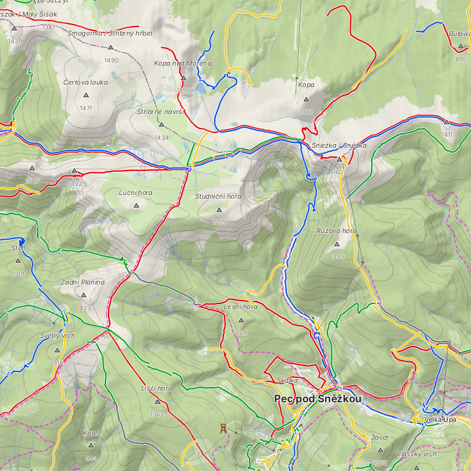

# GeoKuk Maps

Offline map layers for [GeoKuk](https://github.com/geokuk-community/geokuk), generated automatically
by GitHub Actions. Each layer belongs to one base map from
[download.mapsforge.org](https://download.mapsforge.org/maps/v5/) and uses the same name and region.

The layers are ordinary Mapsforge files, so other Mapsforge-based apps can use them too.

## Layers

| Layer | File | Content |
|---|---|---|
| Tourist | `<region>.tourist.map` | Marked hiking, cycling, ski and horse routes, including Czech/Slovak trail colours and the names of official hiking routes; rocks, crosses, guideposts, information boards, viewpoints, solitary trees, ridges, mines, bunkers, fords, weirs, hunting stands, shelters, path difficulty (`sac_scale`, `mtb:scale`, `trail_visibility`, `incline`) and other outdoor features that the base maps do not contain |
| Contours | `<region>.contours.map` | Contour lines |
| Elevation | `<region>.dem.zip` | Elevation tiles (`.hgt`, 1 arc-second) for hillshading |

`<region>` is the path of the base map on download.mapsforge.org without the extension, for example:

    europe/czech-republic.map            (base map, from mapsforge)
    europe/czech-republic.tourist.map
    europe/czech-republic.contours.map
    europe/czech-republic.dem.zip

Base maps are not hosted here. Download them from download.mapsforge.org or its mirrors.

## How GeoKuk draws the layers

GeoKuk draws an offline map with its built-in **GeoKuk** theme: a clear outdoor map for orientation
in the terrain, designed for these layers. In **Maps → Map management** a layer is downloaded next to
its base map, and GeoKuk then draws the base map and all of its downloaded layers together, without
further settings.

Map data © OpenStreetMap contributors (ODbL). Elevation data and contours in the Czech Republic: Zdroj: ČÚZK (CC BY 4.0);
outside the Czech Republic: Copernicus DEM GLO-30 © DLR/Airbus, ESA (see Sources and licences).

The screenshots show GeoKuk offline maps made from OpenStreetMap data: the base map with GeoKuk's own
layers (tourist, contour lines and hillshading) in GeoKuk's own look (the GeoKuk theme).

What the theme draws from the layers:

| Layer | In the GeoKuk theme |
|---|---|
| Tourist | Marked hiking routes in their trail colours, cycling and MTB routes, names of official hiking routes along the line (from zoom 15); viewpoints (from zoom 13), waterfalls, rocks and stones (from zoom 14), cliffs, guideposts, wayside crosses and shrines (from zoom 15) |
| Contours | Contour lines every 100 m from zoom 12, every 50 m from zoom 13, every 10 m from zoom 15, elevation labels from zoom 17 |
| Elevation | Hillshading from zoom 9 to 17 |

The tourist layer carries more features than the GeoKuk theme draws (ski and horse routes, information boards,
solitary trees, hunting stands, shelters, path difficulty and others). Other Mapsforge themes can use them.

## Download

Each generation is published as a release tagged `layers-YYYY-MM`. Asset names use `_` instead of `/`,
for example `europe_germany_bayern.tourist.map`.

The catalogue of all files, with sizes, SHA-256 checksums and dates, is always available at:

    https://github.com/geokuk-community/geokuk-maps/releases/latest/download/layers.json

GeoKuk downloads layers through **Maps → Map management** and stores them in its `layers/` folder,
using the same folder structure as the base maps.

### Reporting problems

Problems in a layer, a theme or the catalogue (a wrong or missing route, contour line or point, a file that does not download)
are reported as an [issue of this repository](https://github.com/geokuk-community/geokuk-maps/issues/new/choose) with the form
"Chyba v mapě nebo vrstvě"; new regions and improvements with "Nový region nebo vylepšení vrstvy". Problems of the GeoKuk program
belong to [geokuk-community/geokuk](https://github.com/geokuk-community/geokuk/issues). Data errors of OpenStreetMap are best fixed
in OpenStreetMap; the layers take them over with the next release.

### Themes

Every release also carries the render themes of GeoKuk from a release of
[geokuk-community/geokuk](https://github.com/geokuk-community/geokuk), each with its `.sha256`:
`GeoKuk-tema.zip` for the maps and layers of GeoKuk (rules for the `fmrel*` route tags, the tourist points and the contour lines)
and `GeoKuk-tema-PAWS.zip` for the maps of [osm.paws.cz](https://osm.paws.cz). They are always available at:

    https://github.com/geokuk-community/geokuk-maps/releases/latest/download/GeoKuk-tema.zip
    https://github.com/geokuk-community/geokuk-maps/releases/latest/download/GeoKuk-tema-PAWS.zip

The GeoKuk release is the input `geokuk` of Layers and Themes: by default the latest release, which is never a prerelease. Until a stable
GeoKuk release has both ZIPs (the first one is 6.5.0-beta.36), give the tag explicitly, for example `v6.5.0-beta.36`.

Before anything is published, the workflows check each ZIP against its `.sha256` and the build provenance attestation of the
GeoKuk release, and check that `GeoKuk-tema.zip` matches the layers (`scripts/theme-check.py`): every tag of `mapping/tourist.xml`
or `mapping/contours.xml` that the theme draws must be in the headers of the tourist and contours maps of the release (a missing tag
stops the release and is listed). A rule for a tag of the layer family (`fmrel*`, `contour_ext`) that the tag mapping does not have,
such as `fmrelbicyclebrown` (`addfmreltags.pl` knows the route colours red, blue, green, yellow, black and white and writes any other
as `…default`), draws nothing and is only a warning. Of `GeoKuk-tema-PAWS.zip` only the loading is checked
(the theme XML parses, every `file:` symbol is in the ZIP). `layers.json` lists `GeoKuk-tema.zip` (id `theme/geokuk`) under the
top-level key `themes`, next to `layers` (file, size, SHA-256, date, GeoKuk version, the maps the theme is for); `GeoKuk-tema-PAWS.zip`
is a release asset only and not in the catalogue. `version` stays 1, and GeoKuk 6.5.0 reads only `version`, `sources` and `layers`.

## Workflows and data sources

Every step runs as a GitHub Actions workflow with its inputs; the scripts in `scripts/` are run by these workflows.
Workflows that refresh data kept in the repository propose the change as a pull request, never by pushing to `main`.
Only the Sources check is scheduled (decided by the maintainer); the frequencies of the other workflows are suggestions for after each has been verified by one run.

| Workflow | What it does | Inputs | Data sources | Output | Suggested frequency | Verified |
|---|---|---|---|---|---|---|
| Layers (`layers.yml`) | Builds the tourist, contours and dem layers of the given regions with their catalogue fragment; publishes them to a draft release, verifies and publishes the draft (`finalize`) or only verifies it (`check`; also runs on its own after every `publish=draft`, job `check-draft`) | `regions`, `types`, `dem_reuse`, `parallel`, `writer`, `publish`, `tag`, `from_run`, `osm_source`, `planet`, `geokuk` | OSM regions cut from the planet on AWS (`osm_source=aws`, row below) or Geofabrik extracts (`osm_source=geofabrik`); Copernicus GLO-30 (AWS Open Data `copernicus-dem-30m`, tiles listed in `mapping/copernicus-tilelist.txt`; dem and contours kept from older releases where `mapping/dem-manifest.json` shows unchanged sources); ČÚZK DMR 4G (ATOM service); mapsforge base map headers (mirror of Hochschule Esslingen); `mapping/` | Artifacts `region-*`; draft release `layers-YYYY-MM` with `layers.json` | Monthly cycle: draft, check, finalize | Last full cycle `layers-2026-10f`. 2026-11-21: dem and contours of Luxembourg kept by `dem_reuse` ([run](https://github.com/geokuk-community/geokuk-maps/actions/runs/44846682096)), `check` of the draft `layers-2026-11` ([run](https://github.com/geokuk-community/geokuk-maps/actions/runs/44846685653)) passed |
| Themes (`themes.yml`) | Adds the GeoKuk themes `GeoKuk-tema.zip` and `GeoKuk-tema-PAWS.zip` of a GeoKuk release to an existing draft release without building the layers, then runs the verification of `check-draft` (Layers adds the themes itself with `publish=draft` or `release`, input `geokuk`; `check-draft`, `check` and `finalize` verify them against the headers of every map of the release) | `tag` (draft release), `geokuk` (default the latest GeoKuk release; a prerelease such as `v6.5.0-beta.36` by its tag) | Release assets of `geokuk-community/geokuk` with `.sha256` and build provenance attestation; `mapping/tourist.xml`, `mapping/contours.xml`; headers of the maps of the release | `GeoKuk-tema.zip`, `GeoKuk-tema-PAWS.zip` with their `.sha256`, and `layers.json` (`themes`: `GeoKuk-tema.zip` only) in the draft release | With each GeoKuk release | Not run yet; pull request checks with the fixtures in `tests/themes` (`tests/themes/run.sh`) |
| Layers: OSM planet blocks (`layers.yml`, jobs `planet` and `split`, with `osm_source=aws`) | Reads the weekly OSM planet once per stream of `mapping/osm-blocks.json`, writes its blocks (checked against the planet's MD5) and cuts the regions from their block with their outlines (smart strategy: complete multipolygon and boundary relations) for the tourist layer and the border: the job `split` takes slices of at most 8 regions of one block (`scripts/osm-blocks.py slices`), downloads the block once and cuts 3 regions per read (`scripts/osm-split.sh`, about 3.1 GB of RAM per region) | `osm_source` (`aws` default, `geofabrik`), `planet` (default the newest), and `regions`, `types` of Layers | OSM planet on AWS Open Data, `s3://osm-planet-eu-central-1/planet/pbf/` (weekly, with `.md5`); `mapping/poly`, `mapping/osm-blocks.json` | Artifacts `osm-block-<block>`, `osm-<region>` (1 day) | With each Layers cycle | 2026-11-21, [run](https://github.com/geokuk-community/geokuk-maps/actions/runs/44846677967) on planet-261116 (Czech Republic, Bavaria, Monaco; tourist): stream `central` (3 blocks) 31.5 min, peak 7.2 GB RAM (about 2.4 GB per block, hence at most 4 blocks per stream), blocks 29.5 GB (central-east 12.7, central-west 11.3, italy 5.5); cutting a region from its block 1.3–3.6 min, 3–3.8 GB RAM; whole run 46 min. Streams of at most 4 blocks ([run](https://github.com/geokuk-community/geokuk-maps/actions/runs/44854005546), 6 regions): `west` (iberia 3.8 GB, france 14.2 GB) 25.5 min, 4.8 GB RAM; `overseas` (4 small blocks) 17 min, 8.8 GB RAM. Smart strategy ([run](https://github.com/geokuk-community/geokuk-maps/actions/runs/44858618494)): tourist layers of africa/egypt and europe/czech-republic within +0.5 % of `layers-2026-10f`; downloading a 12.7 GB block took 2–16 min. Full run [44886196372](https://github.com/geokuk-community/geokuk-maps/actions/runs/44886196372) (one block download per region): downloading the 14.2 GB france block took about 15 min for each of its regions, cutting 4–7 min; job `split` not run yet |
| Region outlines (`poly.yml`) | Refreshes `mapping/poly` with `scripts/update-poly.sh`, one file at a time | `keys` (empty = all) | `https://ftp-stud.hs-esslingen.de/pub/Mirrors/download.mapsforge.org/maps/poly/<key>.poly` | Pull request from `update/poly` | Monthly | 2026-11-21, [run](https://github.com/geokuk-community/geokuk-maps/actions/runs/44846667809): 132 outlines unchanged, 5 min |
| Copernicus tile list (`tilelist.yml`) | Refreshes `mapping/copernicus-tilelist.txt` with `scripts/update-tilelist.sh` (one download) | – | `https://copernicus-dem-30m.s3.amazonaws.com/tileList.txt` | Pull request from `update/tilelist` | Quarterly (the data set dates from 2022) | 2026-11-21, [run](https://github.com/geokuk-community/geokuk-maps/actions/runs/44846671252): unchanged |
| DEM manifest (`dem-manifest.yml`) | Records in `mapping/dem-manifest.json` the release of the dem and contours of every region of a release's `layers.json`, with the fingerprint of their sources (`scripts/dem-source.py update`) | `tag` (default the latest release) | `layers.json` of the release; `mapping/copernicus-tilelist.txt`, `mapping/poly`; ČÚZK DMR 4G ATOM feed `https://atom.cuzk.gov.cz/DMR4G-SJTSK/DMR4G-SJTSK.xml` (Czech Republic, read once) | Pull request from `update/dem-manifest` | After each finalized release | 2026-11-21, [run](https://github.com/geokuk-community/geokuk-maps/actions/runs/44846674537) with `layers-2026-10f`: opened #22 (adds the ČÚZK fingerprint of the Czech Republic) |
| Sources check (`sources-check.yml`) | Checks that the sources are available with light requests only (HEAD, the first 64 KiB by Range, small indexes; each check tried 3 times, `scripts/sources-check.sh`; the step has a 20-minute limit, and a check that did not finish counts as an outage) and writes the table to the run summary. An outage opens the issue "Nedostupné zdroje map: …" with the label `zdroje` (assigned to the maintainer), or adds a comment to the open one; when everything is available again it adds "Zdroje jsou znovu dostupné" (`scripts/sources-issue.sh`). It never closes the issue | `test_url` (an extra URL, for testing the outage handling) | `download.mapsforge.org` and the mirror of Hochschule Esslingen (`maps/v5/europe/monaco.map` with size and date against the original, `maps/poly/europe/monaco.poly`); OSM planet on AWS (listing, newest planet and its `.md5`); Geofabrik (index, `europe/monaco-latest.osm.pbf`; tried once and only a warning, since the layers use the planet on AWS); Copernicus GLO-30 (`tileList.txt`, one tile); ČÚZK DMR 4G (ATOM feed, one sheet); Osmosis on GitHub, Maven Central (mapsforge-map-writer), PyPI (pyhgtmap); `releases/latest/download/layers.json` (valid JSON, version 1) | Run summary; issue with the label `zdroje` | Scheduled: Monday and Thursday 05:17 UTC | See the pull request that added it |
| OSM test sample (`osm-sample.yml`) | Copies the region extracts `osm-<region>` of a Layers run with `osm_source=aws` into `tests/osm` (each below 5 MB), which the pull request checks of Layers use (`osm_source=sample`, region `europe/monaco`) instead of Geofabrik | `from_run` (Layers run id), `regions` (default `europe/monaco`) | Artifacts of that run (cut from the OSM planet on AWS Open Data) | Pull request from `update/osm-sample` | After a planet run, when the samples are older than a few months | 2026-11-21, [run](https://github.com/geokuk-community/geokuk-maps/actions/runs/44858616768) from Layers run 44846677967: opened #27 (`europe/monaco`, 746 422 bytes, planet-261116) |

Data kept in the repository:

| File or folder | Source | Workflow | Suggested frequency |
|---|---|---|---|
| `mapping/poly/<key>.poly` | mapsforge polygons, `maps/poly/<key>.poly` on the mirror of Hochschule Esslingen | Region outlines | Monthly |
| `mapping/region-parts.json` | Written in this repository: regions whose dem and contours are built in parts (2 GiB limit of release assets); `regions=all` of Layers adds their parts (`scripts/region-list.py`) | – | When a layer nears 2 GiB |
| `mapping/osm-blocks.json` | Written in this repository: planet blocks and streams (`scripts/osm-blocks.py check` verifies that every region has a block) | – | When regions are added |
| `mapping/*.xml` | Written in this repository (tag mappings) | – | – |
| `tests/themes/` | Written in this repository: fixture themes shaped like the GeoKuk themes, the tags of the headers of the Czech tourist and contours maps of `layers-2026-10f`/`10e`, and their layers from `layers.json`; stubs of `gh` and `curl` for the test of `publish.sh` adding the themes to an existing draft; used by the pull request checks | – | When the themes or the catalogue change |
| `tests/osm/<region>.osm.pbf`, `.txt` | OSM extract of the region cut from the weekly planet (AWS Open Data), with the planet name and date; used by the pull request checks | OSM test sample | A few times a year |
| `mapping/copernicus-tilelist.txt` | `https://copernicus-dem-30m.s3.amazonaws.com/tileList.txt` | Copernicus tile list | Quarterly |
| `mapping/dem-manifest.json` | Release of the dem and contours of each region and the fingerprint of their sources; Layers keeps them when the fingerprint is unchanged (`dem_reuse=changed`) | DEM manifest | After each finalized release |

## Sources and licences

**Tourist** – © OpenStreetMap contributors, data available under the
[Open Database License (ODbL)](https://opendatacommons.org/licenses/odbl/).
Regions cut from the weekly planet file on [AWS Open Data](https://registry.opendata.aws/osm/) (`osm-planet-eu-central-1`), or extracts
from [Geofabrik](https://download.geofabrik.de/) with `osm_source=geofabrik`. The region outlines in `mapping/poly` are those of the mapsforge
base maps (`maps/poly` on download.mapsforge.org, read from the mirror of Hochschule Esslingen; refresh with `scripts/update-poly.sh`).

**Czech Republic elevation data and contours** – Zdroj: ČÚZK, [CC BY 4.0](https://creativecommons.org/licenses/by/4.0/) (Digital Terrain Model of the Czech Republic 4th generation, DMR 4G), completed from Copernicus outside the country.

**Contours and elevation data** – produced using Copernicus WorldDEM-30 © DLR e.V. 2010-2014
and © Airbus Defence and Space GmbH 2014-2018 provided under COPERNICUS by the European Union
and ESA; all rights reserved.

The organisations in charge of the Copernicus programme by law or by delegation do not incur any
liability for any use of the Copernicus WorldDEM-30.

Anyone who redistributes these files must keep the attributions above and is bound by the same
conditions ([COP-DEM-GLO-30-F licence](https://spacedata.copernicus.eu/documents/20123/121286/CSCDA_ESA_Mission-specific+Annex_31_Oct_22.pdf)).
This project is not endorsed by ESA, the European Union, DLR or Airbus.

**Tools** – [osmium-tool](https://osmcode.org/osmium-tool/),
[mapsforge-map-writer](https://github.com/mapsforge/mapsforge) (LGPL-3.0),
[pyhgtmap](https://github.com/agrenott/pyhgtmap), addfmreltags (GPL-3.0-or-later, modified;
source in this repository).

The scripts and workflows in this repository are licensed under GPL-3.0-or-later, like GeoKuk.

## Česky

Vrstvy k offline mapám programu GeoKuk: turistické a cyklotrasy s body pro orientaci v terénu, vrstevnice a výšková data pro
stínování terénu. Každá vrstva patří k jedné mapě z download.mapsforge.org a má stejný název.
GeoKuk je stahuje sám v okně **Mapy → Správa map**. Ručně stažené soubory patří do složky `layers/`
se stejnou strukturou podsložek, jakou mají mapy. GeoKuk je kreslí vestavěným tématem **GeoKuk**
(přehledná turistická mapa): značené trasy v barvách značení s názvy oficiálních tras, skály,
vyhlídky, rozcestníky, kříže, vodopády, vrstevnice po 10 m a stínování terénu.

Chyby ve vrstvách, tématech a katalogu se hlásí v [issues tohoto repozitáře](https://github.com/geokuk-community/geokuk-maps/issues/new/choose)
formulářem „Chyba v mapě nebo vrstvě“, návrhy formulářem „Nový region nebo vylepšení vrstvy“. Chyby programu GeoKuk patří do
[geokuk-community/geokuk](https://github.com/geokuk-community/geokuk/issues).

Každé vydání obsahuje i témata GeoKuku z vydání geokuk-community/geokuk: `GeoKuk-tema.zip` k mapám a vrstvám GeoKuku
a `GeoKuk-tema-PAWS.zip` k mapám osm.paws.cz, vždy na adrese
`https://github.com/geokuk-community/geokuk-maps/releases/latest/download/<soubor>`. Workflow před vydáním ověří kontrolní součet
a attestation obou ZIPů a to, že každá značka vrstev, kterou téma GeoKuk kreslí, ve vrstvách vydání opravdu je. V katalogu
`layers.json` je jen `GeoKuk-tema.zip`. Dokud stabilní vydání GeoKuku obě témata nemá, zadává se vstup `geokuk` tagem
(např. `v6.5.0-beta.36`).
