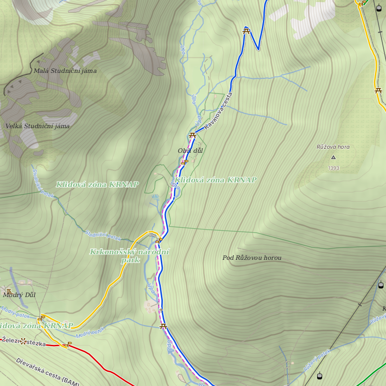

# GeoKuk Maps

Offline map layers for [GeoKuk](https://github.com/geokuk-community/geokuk), generated automatically
by GitHub Actions. Each layer belongs to one base map from
[download.mapsforge.org](https://download.mapsforge.org/maps/v5/) and uses the same name and region.

The layers are ordinary Mapsforge files, so other Mapsforge-based apps can use them too.

## Layers

| Layer | File | Content |
|---|---|---|
| Tourist | `<region>.tourist.map` | Marked hiking, cycling, ski and horse routes, including Czech/Slovak trail colours and the names of official hiking routes; rocks, crosses, guideposts, information boards, viewpoints, solitary trees, ridges, mines, bunkers, fords, weirs, hunting stands, shelters, path difficulty (`sac_scale`, `mtb:scale`, `trail_visibility`, `incline`) and other outdoor features that the base maps do not contain |
| Contours | `<region>.contours.map` | Contour lines |
| Elevation | `<region>.dem.zip` | Elevation tiles (`.hgt`, 1 arc-second) for hillshading |

`<region>` is the path of the base map on download.mapsforge.org without the extension, for example:

    europe/czech-republic.map            (base map, from mapsforge)
    europe/czech-republic.tourist.map
    europe/czech-republic.contours.map
    europe/czech-republic.dem.zip

Base maps are not hosted here. Download them from download.mapsforge.org or its mirrors.

## How GeoKuk draws the layers

GeoKuk draws an offline map with its built-in **GeoKuk** theme: a clear outdoor map for orientation
in the terrain, designed for these layers. In **Maps → Map management** a layer is downloaded next to
its base map, and GeoKuk then draws the base map and all of its downloaded layers together, without
further settings.

Map data © OpenStreetMap contributors (ODbL). Elevation data and contours in the Czech Republic: Zdroj: ČÚZK (CC BY 4.0);
outside the Czech Republic: Copernicus DEM GLO-30 © DLR/Airbus, ESA (see Sources and licences).

The screenshots show GeoKuk offline maps made from OpenStreetMap data: the base map with GeoKuk's own
layers (tourist, contour lines and hillshading) in GeoKuk's own look (the GeoKuk theme).

What the theme draws from the layers:

| Layer | In the GeoKuk theme |
|---|---|
| Tourist | Marked hiking routes in their trail colours, cycling and MTB routes, names of official hiking routes along the line (from zoom 15); viewpoints (from zoom 13), waterfalls, rocks and stones (from zoom 14), cliffs, guideposts, wayside crosses and shrines (from zoom 15) |
| Contours | Contour lines every 100 m from zoom 12, every 50 m from zoom 13, every 10 m from zoom 15, elevation labels from zoom 17 |
| Elevation | Hillshading from zoom 9 to 17 |

The tourist layer carries more features than the GeoKuk theme draws (ski and horse routes, information boards,
solitary trees, hunting stands, shelters, path difficulty and others). Other Mapsforge themes can use them.

## Download

Each generation is published as a release tagged `layers-YYYY-MM`. Asset names use `_` instead of `/`,
for example `europe_germany_bayern.tourist.map`.

The catalogue of all files, with sizes, SHA-256 checksums and dates, is always available at:

    https://github.com/geokuk-community/geokuk-maps/releases/latest/download/layers.json

GeoKuk downloads layers through **Maps → Map management** and stores them in its `layers/` folder,
using the same folder structure as the base maps.

## Workflows and data sources

Every step runs as a GitHub Actions workflow with its inputs; the scripts in `scripts/` are run by these workflows.
Workflows that refresh data kept in the repository propose the change as a pull request, never by pushing to `main`.
No workflow is scheduled yet; the frequencies below are suggestions for after each workflow has been verified by one run.

| Workflow | What it does | Inputs | Data sources | Output | Suggested frequency | Verified |
|---|---|---|---|---|---|---|
| Layers (`layers.yml`) | Builds the tourist, contours and dem layers of the given regions with their catalogue fragment; publishes them to a draft release, verifies and publishes the draft (`finalize`) or only verifies it (`check`) | `regions`, `types`, `dem_reuse`, `parallel`, `writer`, `publish`, `tag`, `from_run`, `osm_source`, `planet` | OSM regions cut from the planet on AWS (`osm_source=aws`, row below) or Geofabrik extracts (`osm_source=geofabrik`); Copernicus GLO-30 (AWS Open Data `copernicus-dem-30m`, tiles listed in `mapping/copernicus-tilelist.txt`; dem and contours kept from older releases where `mapping/dem-manifest.json` shows unchanged sources); ČÚZK DMR 4G (ATOM service); mapsforge base map headers (mirror of Hochschule Esslingen); `mapping/` | Artifacts `region-*`; draft release `layers-YYYY-MM` with `layers.json` | Monthly cycle: draft, check, finalize | Last full cycle `layers-2026-10f`; since 2026-11-20 Geofabrik refuses connections from GitHub runners |
| Layers: OSM planet blocks (`layers.yml`, jobs `planet` and `border`, with `osm_source=aws`) | Reads the weekly OSM planet once per stream of `mapping/osm-blocks.json`, writes its blocks (checked against the planet's MD5) and cuts each region from its block with its outline (complete_ways) for the tourist layer and the border | `osm_source` (`aws` default, `geofabrik`), `planet` (default the newest), and `regions`, `types` of Layers | OSM planet on AWS Open Data, `s3://osm-planet-eu-central-1/planet/pbf/` (weekly, with `.md5`); `mapping/poly`, `mapping/osm-blocks.json` | Artifacts `osm-block-<block>`, `osm-<region>` (1 day) | With each Layers cycle | Not run yet (pull requests use `geofabrik`) |
| Region outlines (`poly.yml`) | Refreshes `mapping/poly` with `scripts/update-poly.sh`, one file at a time | `keys` (empty = all) | `https://ftp-stud.hs-esslingen.de/pub/Mirrors/download.mapsforge.org/maps/poly/<key>.poly` | Pull request from `update/poly` | Monthly | Not run yet |
| Copernicus tile list (`tilelist.yml`) | Refreshes `mapping/copernicus-tilelist.txt` with `scripts/update-tilelist.sh` (one download) | – | `https://copernicus-dem-30m.s3.amazonaws.com/tileList.txt` | Pull request from `update/tilelist` | Quarterly (the data set dates from 2022) | Not run yet |
| DEM manifest (`dem-manifest.yml`) | Records in `mapping/dem-manifest.json` the release of the dem and contours of every region of a release's `layers.json`, with the fingerprint of their sources (`scripts/dem-source.py update`) | `tag` (default the latest release) | `layers.json` of the release; `mapping/copernicus-tilelist.txt`, `mapping/poly`; ČÚZK DMR 4G ATOM feed `https://atom.cuzk.gov.cz/DMR4G-SJTSK/DMR4G-SJTSK.xml` (Czech Republic, read once) | Pull request from `update/dem-manifest` | After each finalized release | Not run yet |

Data kept in the repository:

| File or folder | Source | Workflow | Suggested frequency |
|---|---|---|---|
| `mapping/poly/<key>.poly` | mapsforge polygons, `maps/poly/<key>.poly` on the mirror of Hochschule Esslingen | Region outlines | Monthly |
| `mapping/osm-blocks.json` | Written in this repository: planet blocks and streams (`scripts/osm-blocks.py check` verifies that every region has a block) | – | When regions are added |
| `mapping/*.xml` | Written in this repository (tag mappings) | – | – |
| `mapping/copernicus-tilelist.txt` | `https://copernicus-dem-30m.s3.amazonaws.com/tileList.txt` | Copernicus tile list | Quarterly |
| `mapping/dem-manifest.json` | Release of the dem and contours of each region and the fingerprint of their sources; Layers keeps them when the fingerprint is unchanged (`dem_reuse=changed`) | DEM manifest | After each finalized release |

## Sources and licences

**Tourist** – © OpenStreetMap contributors, data available under the
[Open Database License (ODbL)](https://opendatacommons.org/licenses/odbl/).
Regions cut from the weekly planet file on [AWS Open Data](https://registry.opendata.aws/osm/) (`osm-planet-eu-central-1`), or extracts
from [Geofabrik](https://download.geofabrik.de/) with `osm_source=geofabrik`. The region outlines in `mapping/poly` are those of the mapsforge
base maps (`maps/poly` on download.mapsforge.org, read from the mirror of Hochschule Esslingen; refresh with `scripts/update-poly.sh`).

**Czech Republic elevation data and contours** – Zdroj: ČÚZK, [CC BY 4.0](https://creativecommons.org/licenses/by/4.0/) (Digital Terrain Model of the Czech Republic 4th generation, DMR 4G), completed from Copernicus outside the country.

**Contours and elevation data** – produced using Copernicus WorldDEM-30 © DLR e.V. 2010-2014
and © Airbus Defence and Space GmbH 2014-2018 provided under COPERNICUS by the European Union
and ESA; all rights reserved.

The organisations in charge of the Copernicus programme by law or by delegation do not incur any
liability for any use of the Copernicus WorldDEM-30.

Anyone who redistributes these files must keep the attributions above and is bound by the same
conditions ([COP-DEM-GLO-30-F licence](https://spacedata.copernicus.eu/documents/20123/121286/CSCDA_ESA_Mission-specific+Annex_31_Oct_22.pdf)).
This project is not endorsed by ESA, the European Union, DLR or Airbus.

**Tools** – [osmium-tool](https://osmcode.org/osmium-tool/),
[mapsforge-map-writer](https://github.com/mapsforge/mapsforge) (LGPL-3.0),
[pyhgtmap](https://github.com/agrenott/pyhgtmap), addfmreltags (GPL-3.0-or-later, modified;
source in this repository).

The scripts and workflows in this repository are licensed under GPL-3.0-or-later, like GeoKuk.

## Česky

Vrstvy k offline mapám programu GeoKuk: turistické a cyklotrasy s body pro orientaci v terénu, vrstevnice a výšková data pro
stínování terénu. Každá vrstva patří k jedné mapě z download.mapsforge.org a má stejný název.
GeoKuk je stahuje sám v okně **Mapy → Správa map**. Ručně stažené soubory patří do složky `layers/`
se stejnou strukturou podsložek, jakou mají mapy. GeoKuk je kreslí vestavěným tématem **GeoKuk**
(přehledná turistická mapa): značené trasy v barvách značení s názvy oficiálních tras, skály,
vyhlídky, rozcestníky, kříže, vodopády, vrstevnice po 10 m a stínování terénu.
